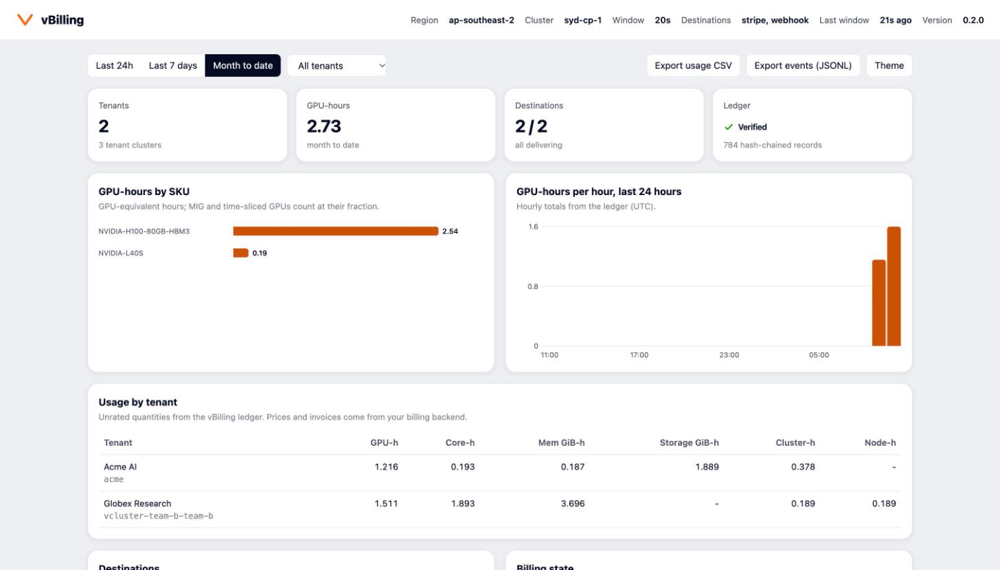

<p align="center">
  
</p>

<p align="center">
  <strong>Usage metering for AI Clouds running vCluster</strong><br>
  Meters clusters to the second, keeps a durable, verifiable ledger, and ships reconcilable usage to Stripe, Metronome, Lago or your own pipeline.
</p>

<p align="center">
  
  <a href="LICENSE"></a>
  
</p>

---

vBilling is the **metering pipe**, not the billing engine. It turns what runs in your clusters into canonical usage events. Your billing platform does the pricing, invoicing, tax and payments. vBilling makes sure every billable GPU-second reaches it exactly once, attributed to the right customer, region and SKU, and that you can prove it afterwards.

> vBilling lives in `vClusterLabs-Experiments`: it is an experimental project, not a supported vCluster Labs product.

**[GPU metering with Stripe](examples/gke-stripe/README.md)** provides a step-by-step setup: shared L4 nodes for internal teams, an optional A100 joined as a private node, usage delivery to Stripe test mode, and resource cleanup. Credentials and runtime data stay outside the repository.

## What's new in v0.3

- **Usage from AI gateways.** `POST /api/v1/records` takes one record per request: from LiteLLM as it posts them, from Kong or any other gateway through a few lines of YAML. Records are on disk before vBilling answers, retries are dropped by request ID, and each window gets one event per tenant, metric and SKU. A record that arrives late becomes a separate adjustment to its own window. vBilling can also read a gateway's own request log back (LiteLLM's spend logs built in, any other logs API from YAML) to fill what the push lost, counting each request once.
- **Exact Prometheus counters.** `counter:` reads a counter's raw samples and bills the exact increase per window, counter resets included, so the windows add up to the true total across restarts and Prometheus outages. `query:` results are marked as estimates on every event and in the catalog. Egress is now a counter.
- **Scoping for every tenancy model.** `{{selector}}` selects a cluster's series by namespace on shared and dedicated nodes, by an external label on clusters with their own nodes, by vCluster Platform labels, or through a Prometheus inside the cluster.
- **Source health.** Every Prometheus metric per cluster, every cluster API, every records client and every cross-check reports `ok`, `empty`, `failing` or `diverged`, with the last success, the last error and a hint, in the API, `/metrics`, the log and the dashboard. A selector that matches nothing no longer looks like zero usage.
- **Cross-checks.** Compare the gateway's tokens with the engine's own counters per tenant and hour, and see divergence before an invoice goes out.
- **Enforcement inside clusters with their own nodes.** `ENFORCEMENT_IN_CLUSTER` installs an admission policy inside a suspended tenant's clusters. Holds keep reasons apart: a payment never lifts an operator's `abuse` hold.
- **Pause that stops billing.** The `paused` state stops a tenant's clusters the way `vcluster pause` does, after draining their own nodes, and capacity stops billing once the drain is verified. The tenant cannot restart them: vBilling pauses a cluster again within 15 seconds if anything else brings it back, and `vcluster connect` refuses a paused cluster instead of resuming it. Clearing the hold (a top-up, an operator) resumes them. Volumes and load balancers keep billing unless `PAUSE_KEEP_BILLING` says otherwise.
- **A dashboard built from the catalog.** Every metric with usage gets a column with its unit, estimates are marked, and each tenant expands to its SKUs.
- **Pricing models.** Ready setups for dedicated GPUs, serverless inference, blended plans and enterprise chargeback ([Pricing Models](https://vclusterlabs-experiments.github.io/vbilling/pricing-models.html)). A Stripe price card (`STRIPE_PRICE_CARD`) creates each plan's meters and prices, including per-million token prices. Cached input tokens are billed as their own metric, and a requested service tier is a dimension.
- **Stopping token customers at the gateway.** In `enforce` mode, `ENFORCEMENT_LITELLM` blocks a suspended or paused tenant's LiteLLM teams and unblocks them when it is active again, lifting only blocks vBilling set.
- **Spot capacity.** `COLLECTION_DELAY` (for example `75s`) waits for Kubernetes to notice a node that died without warning before its last window is billed.
- **Smaller additions.** Custom metrics as a YAML list, including informational ones (`billable: false`); a plan per tenant class (`PLAN_BY_CLASS`); Lago price cards and managed plans.

See [Usage sources](https://vclusterlabs-experiments.github.io/vbilling/usage-sources.html) for what each source guarantees.

## What's new in v0.2

- **Stripe and Metronome adapters.** Use Stripe Billing Meters on their own, or Metronome for rating with Stripe for payment, invoicing and tax. vBilling creates the Stripe customer and links it in Metronome.
- **Durable, hash-chained ledger.** Every window is committed atomically to disk before any billing platform sees it. If vBilling restarts or a billing platform has an outage, no usage is lost, and missed windows are backfilled.
- **Several destinations at once.** Each destination has its own cursor, so a down billing API never blocks your data platform feed.
- **Deterministic event IDs.** Retries and replays deduplicate downstream.
- **Second-level allocation metering.** GPU time is metered from container start to finish, including fractional GPUs (MIG mixed and single strategy, GKE GPU partitions, time-slicing including GKE time-sharing) and GPUs allocated through DRA ResourceClaims.
- **Every tenancy model.** Shared nodes and dedicated nodes are metered from the control plane cluster. Clusters with their own nodes (vCluster Private Nodes, Auto Nodes, Standalone) are metered through their own API, with a read-only kubeconfig vCluster exports for vBilling. No node is ever billed twice.
- **Nothing slips between windows.** Pods and nodes deleted between two collections (short jobs, Auto Nodes scale-down) are billed until the second they were deleted.
- **Bill anything Prometheus knows.** Define billable metrics as PromQL (inference tokens from vLLM, any exporter's counter), or read vCluster Platform fleet observability with one preset.
- **Fair metering.** GPU time on NotReady or unhealthy nodes is not billed. It is recorded as auditable downtime instead.
- **Reconciliation API.** It recomputes usage from the ledger and compares it with what Stripe or Metronome recorded.
- **Billing-state enforcement.** Payment failures and spend alerts can label, annotate or soft-suspend clusters.
- **Ingest API.** Accepts usage vBilling cannot see itself: inference tokens, Slurm accounting, storage and network exporters.
- **Built-in dashboard, Prometheus metrics, and CSV/JSONL exports.**
- **An end-to-end example on GKE.** [`examples/gke-gpu`](examples/gke-gpu) goes from an empty project to Stripe invoices: a time-sliced L4 cluster, an A100 joined as a private node with the NVIDIA GPU Operator and MIG, DCGM through your own Prometheus, and a spot preemption billed to the second.

## Architecture

```
  Control plane cluster (one per region)                       Destinations
 ┌───────────────────────────────────────────────────────┐
 │ tenant clusters: team-a (shared) team-c (spot)        │
 │                  team-b (dedicated 8x H100)           │
 │        pods · PVCs · load balancers · nodes           │    ┌─► Stripe Billing Meters
 │                        │                              │    │
 │  ┌─────────────────────▼───────────────────────────┐  │    ├─► Metronome ──► Stripe (payments, tax)
 │  │ vBilling                                        │  │    │
 │  │  discover ─► meter window ─► ledger (PVC) ─► fan-out ───┼─► Lago
 │  │                 ▲            hash-chained       │  │    │
 │  │  ingest API ────┘            one cursor per     │  │    └─► webhook: CloudEvents to your data platform
 │  │  (tokens, Slurm, ...)        destination        │  │
 │  │                                                 │  │
 │  │  enforcement ◄── /webhooks ◄──────────────────────────── Stripe dunning, Metronome alerts
 │  │  label · annotate · admission policy            │  │
 │  │  API + dashboard: usage, exports, reconcile     │  │
 │  └─────────────────────────────────────────────────┘  │
 └───────────────────────────────────────────────────────┘
```

1. **Discover** clusters (vCluster StatefulSets and Deployments, enriched from vCluster Platform when available) and group them into billing tenants.
2. **Meter** each closed window (60s by default, aligned to the wall clock) into canonical events.
3. **Commit** the window atomically to the ledger.
4. **Deliver** to every destination at least once, with deterministic IDs so the effect is exactly-once.
5. **Close the loop**: billing webhooks drive the tenant's billing state back onto its clusters.

## What gets metered

| Metric | Unit | How | Key dimensions |
|---|---|---|---|
| `vcluster_gpu_hours` | gpu-hours | Container start to finish, per second. MIG at slices/7 (A30: /4) under the single or mixed strategy and on GKE GPU partitions, time-sliced at 1/replicas. Dedicated nodes in whole GPUs | `sku`, `gpu_profile`, `capacity_type`, `billing_mode`, `zone` |
| `vcluster_cpu_core_hours` | core-hours | metrics-server usage, requests, or the larger of both (`CPU_MEMORY_BASIS`) | `capacity_type`, `billing_mode` |
| `vcluster_memory_gb_hours` | gib-hours | As CPU | `capacity_type`, `billing_mode` |
| `vcluster_private_node_hours` | node-hours | Whole nodes dedicated to a cluster, per node | `sku` (SKU label or instance type), `capacity_type` |
| `vcluster_storage_gb_hours` | gib-hours | Bound PVCs synced from the cluster | `sku` = storage class |
| `vcluster_instance_hours` | hours | Control plane hours while ready (not while provisioning or asleep) | `tenant_class` |
| `vcluster_lb_hours` | hours | LoadBalancer services with an assigned address | |
| `vcluster_network_egress_gb` | gib | Prometheus counter `container_network_transmit_bytes_total`, read sample by sample: the exact byte increase per window. `EGRESS_QUERY` replaces it with PromQL, an estimate | |
| `vcluster_gpu_utilization` | util-hours | DCGM via Prometheus (`namespace` or `exported_namespace` labels, or the cluster's matchers for clusters with their own nodes; GPUs in MIG mode by instance engine activity), or your `GPU_UTIL_QUERY`. An estimate. Informational: never sent to Stripe or Metronome | `gpu_type` |
| `vcluster_gpu_downtime_hours` | gpu-hours | Allocated GPU time on NotReady/unhealthy nodes, and GPUs a dedicated or private node has installed but cannot allocate (a driver restarting after a reboot or a MIG change). Informational: an audit trail of credits | `gpu_type`, `node` |
| custom (`metering.customMetrics`, records formats, `prometheus.metrics`) | yours | Per-request records from AI gateways, window totals through the ingest API (Slurm GPU-hours, ...), or Prometheus counters and queries | yours |

Every event carries `tenant`, `region`, `project`, `sku`, `resource_id`, `tenant_cluster`, the window, and a stable ID. Schema: [`docs/schema/usage-event.v1.json`](docs/schema/usage-event.v1.json).

```json
{
  "schema_version": "vbilling.usage/v1",
  "id": "vb1_d26414a201f1c0e1a4c1b0f0b7e6c2aa",
  "tenant": "acme",
  "metric": "vcluster_gpu_hours",
  "quantity": 0.027222222,
  "unit": "gpu-hours",
  "window_start": "2026-10-05T09:58:00Z",
  "window_end": "2026-10-05T09:58:20Z",
  "region": "ap-southeast-2",
  "project": "training",
  "sku": "NVIDIA-H100-80GB-HBM3",
  "resource_id": "vcluster-team-a-team-a",
  "dimensions": {
    "tenant_cluster": "vcluster-team-a-team-a", "gpu_type": "NVIDIA-H100-80GB-HBM3",
    "gpu_profile": "full", "capacity_type": "on-demand", "billing_mode": "shared",
    "tenant_class": "public", "zone": "syd-1a"
  },
  "properties": {"gpu_devices": 6, "pods": 3, "backfilled": true},
  "source": "collector",
  "recorded_at": "2026-10-05T09:59:08Z"
}
```

*(That event is real output from the end-to-end test. A new 2-GPU pod started 11 seconds into the window while vBilling was down, and the backfill billed exactly its 9 seconds.)*

### Metering rules that protect tenants

- **Billing starts when a container starts**, not when the pod is created, so image pulls and scheduling are free. It stops when the last container finishes.
- **Hardware downtime is not billed.** GPU time on a node that is NotReady, or carries a taint listed in `UNHEALTHY_NODE_TAINTS`, becomes `vcluster_gpu_downtime_hours` instead of `vcluster_gpu_hours`. A node that stops reporting (a preempted spot VM) is down from its last heartbeat or Lease renewal, not from the Unknown mark 40 to 50 seconds later. So does a node billed whole whose GPUs are installed (GPU Feature Discovery's `nvidia.com/gpu.count`) but not allocatable, for example while the driver rebuilds after a reboot.
- **Provisioning and sleep are free.** Control plane hours accrue only while the cluster has a ready replica.
- **No double billing.** Pods on a tenant's own dedicated nodes are covered by the node allocation. The cluster's own control plane pods and data PVCs are covered by instance hours (set `METER_CONTROL_PLANE=true` to bill them as well).
- **No invented usage.** Backfilled windows include only what is knowable: object lifetimes (allocations, requests) and the raw samples of Prometheus counters, egress included. Sampled usage (metrics-server CPU and memory) is never extrapolated into backfilled windows.
- **Deleted is not free, and not overbilled.** A pod or node deleted between collections is billed until it was deleted. A deletion noticed only after a watch reconnects is dated to the last collection that still saw it, so an outage can only under-bill.

## Tenancy models

| Tenancy model | Where workloads run | How vBilling meters it |
|---|---|---|
| Shared nodes | Control plane cluster nodes, pods synced by vCluster | From the control plane cluster: pods, volumes, load balancers (`billing_mode=shared`) |
| Dedicated nodes | Control plane cluster nodes assigned to one cluster | Whole node: node-hours, whole GPUs, CPU and memory capacity (`billing_mode=dedicated_node`) |
| Private Nodes, Auto Nodes | Machines joined to the cluster itself; nothing is synced to the control plane cluster | Through the cluster's own API: each private node billed whole (`billing_mode=private_node`), plus the cluster's volumes and load balancers. `PRIVATE_NODE_BILLING=usage` bills the pods on them instead |
| Standalone, or any cluster elsewhere | No control plane cluster | Through a kubeconfig listed in `TENANT_CLUSTERS_FILE`, like private nodes |

A node the cluster's API reports is billed as a private node only if the control plane cluster does not have it and it is not one of vCluster's placeholder nodes (`vcluster.loft.sh/fake-node`). Shared clusters are therefore never billed twice, even with tenant API access configured. Label a node `vbilling.vcluster.com/billable=false` to exempt hardware the tenant owns.

**Least-privilege access.** vBilling reads one Secret per cluster, `vbilling-kubeconfig` in its namespace, and its RBAC is pinned to that Secret name. vCluster writes it with a read-only service account:

```yaml
# vcluster.yaml (vCluster 0.36+)
exportKubeConfig:
  additionalSecrets:
    - name: vbilling-kubeconfig
      serviceAccount:
        name: vbilling-reader
        namespace: kube-system
        clusterRole: vbilling-reader
experimental:
  deploy:
    vcluster:
      manifests: |-
        apiVersion: rbac.authorization.k8s.io/v1
        kind: ClusterRole
        metadata:
          name: vbilling-reader
        rules:
          - apiGroups: [""]
            resources: [nodes, pods, persistentvolumeclaims, services]
            verbs: [get, list, watch]
          - apiGroups: [resource.k8s.io]
            resources: [resourceclaims, resourceslices]
            verbs: [get, list]
          - apiGroups: [metrics.k8s.io]
            resources: [pods]
            verbs: [get, list]
```

vCluster exports kubeconfigs for `localhost`; vBilling connects to the cluster's Service instead and verifies TLS against `<name>.<namespace>`. vBilling never uses a cluster's admin kubeconfig, and with `TENANT_SOURCE=platform` it reaches clusters only through the vCluster Platform proxy.

**Outages.** If a cluster's API cannot be read, the rest of the fleet is still metered, and the missed windows are filled as soon as it answers (up to 6 hours back). Fills are late ledger events deduplicated by ID, so a repeated fill never bills twice.

## Billing adapters

Select one or more with `ADAPTERS` (Helm: `adapters`). Each has a full guide on the docs site: [Stripe](https://vclusterlabs-experiments.github.io/vbilling/stripe.html), [Metronome](https://vclusterlabs-experiments.github.io/vbilling/metronome.html), [Lago](https://vclusterlabs-experiments.github.io/vbilling/lago.html) and the [Custom Billing Adapter](https://vclusterlabs-experiments.github.io/vbilling/custom-adapter.html) (webhook, ingest API, or your own Go adapter).

| Adapter | What vBilling does | Pricing lives in |
|---|---|---|
| `stripe` | Creates [Billing Meters](https://docs.stripe.com/billing/subscriptions/usage-based) and posts meter events. Meters are split per SKU (`STRIPE_SPLIT_METERS_BY`) because Stripe meters cannot price on dimensions. Customers are created idempotently and never duplicated. Optionally subscribes tenants to prices tagged `metadata[vbilling_plan]`. Reconciles via meter event summaries. | Stripe prices on each meter |
| `metronome` | Ingests usage keyed on the tenant ID as the customer's ingest alias, and reads Metronome to check that every SKU has a rate on the customer's contract. Your customers, billable metrics and contracts stay yours: usage sent before a customer has the alias is attached when it does. Reconciles via `/v1/usage`. `vbilling metronome billable-metrics` prints the billable metrics to add to your catalog. | Metronome rate cards (pricing group keys) |
| `metronome` + `METRONOME_PROVISION=true` | Also creates the billable metrics and each tenant's customer, a contract on `METRONOME_RATE_CARD`, and with `STRIPE_API_KEY` a linked Stripe customer, so **Metronome rates and Stripe collects payment, invoices and tax**. | Metronome |
| `lago` | Customers, subscriptions and the default plan, plus events whose dimensions are properties for Lago charge filters. Adds a charge for metrics declared later, and a charge filter for each new SKU, without touching prices set in Lago. An optional price card (`LAGO_PRICE_CARD`) sets the amounts of what it creates. | Lago plans and charges |
| `webhook` | Signed CloudEvents 1.0 batches (`application/cloudevents-batch+json`), including tenant, offboarding and catalog events. Use it to feed a data platform, Kafka bridge or homegrown rating engine. | wherever you send it |
| `noop` | Logs events (dry run). | n/a |

**Price coverage.** A billing platform bills usage it has no price for at $0, without an error. vBilling reads (never writes) each platform's pricing and reports every billable metric and recent series (metric, SKU, plan) it cannot price: a Metronome rate on the tenant's rate card, an active Stripe price on the SKU's meter, a Lago charge and SKU price. `PRICE_CHECK=hold` also keeps that usage out of the platform until the price exists, then ships it in order. See `GET /api/v1/pricing` and [Unpriced usage](https://vclusterlabs-experiments.github.io/vbilling/troubleshooting.html#unpriced-usage).

Stripe acquired Metronome in January 2026. Both paths are supported here: Billing Meters for straightforward pay-as-you-go, Metronome for dimensional pricing, commits, credits and multi-currency rate cards.

## Quick start

Images for `linux/amd64` and `linux/arm64` are published to `ghcr.io/vclusterlabs-experiments/vbilling`, the chart's default. Install from a release tag: `main` can be ahead of the published image. Each [release](https://github.com/vClusterLabs-Experiments/vbilling/releases) also has the packaged chart attached (`helm upgrade --install vbilling https://github.com/vClusterLabs-Experiments/vbilling/releases/download/v0.3.1/vbilling-0.3.1.tgz ...`). Keep billing keys in Secrets, never in `--set` flags or values files:

```bash
git clone --branch v0.3.1 https://github.com/vClusterLabs-Experiments/vbilling.git && cd vbilling
kubectl create namespace vbilling-system
```

**Stripe (test mode)**

```bash
kubectl -n vbilling-system create secret generic vbilling-stripe --from-file=api-key=./stripe-test-key
helm upgrade --install vbilling deploy/helm/vbilling -n vbilling-system \
  --set adapters='{stripe}' --set stripe.existingSecret=vbilling-stripe \
  --set region=ap-southeast-2 --set clusterName=syd-1
```

vBilling creates one meter per metric (and per SKU as it sees them). Attach metered prices to the meters you want to charge for. To have vBilling subscribe each new tenant automatically, tag those prices with `metadata[vbilling_plan]=vcluster-standard` and set `stripe.autoSubscribe=true`.

**Metronome rating, Stripe payments**

With `metronome.provision=true`, vBilling sets Metronome up: billable metrics, a customer per tenant, a contract on the rate card, and a linked Stripe customer. If your own portal already creates customers and contracts, leave it off: vBilling then only sends usage, keyed on the tenant ID as the customer's ingest alias.

```bash
kubectl -n vbilling-system create secret generic vbilling-metronome --from-file=api-token=./metronome-token
kubectl -n vbilling-system create secret generic vbilling-stripe --from-file=api-key=./stripe-live-key
kubectl -n vbilling-system create secret generic vbilling-webhook --from-file=secret=./webhook-secret
helm upgrade --install vbilling deploy/helm/vbilling -n vbilling-system \
  --set adapters='{metronome,webhook}' \
  --set metronome.existingSecret=vbilling-metronome --set metronome.rateCard=payg-aud \
  --set metronome.provision=true --set stripe.existingSecret=vbilling-stripe \
  --set webhook.url=https://data.example.com/usage --set webhook.existingSecret=vbilling-webhook \
  --set region=ap-southeast-2
```

In Metronome, add products on vBilling's billable metrics (`vbilling metronome billable-metrics` prints them for your catalog) with `pricing_group_key: ["region","sku","capacity_type","billing_mode"]` and `presentation_group_key: ["tenant_cluster"]` (together they must form the metric's group key) to price H100 differently from L40S, one region differently from another, and spot or preemptible at a flat discount. Rate cards carry the currency.

**Shared and private GPU nodes on GKE**: [`examples/gke-gpu`](examples/gke-gpu) is a complete setup, from an empty project to Stripe invoices: a time-sliced L4 cluster, an A100 joined as a vCluster private node, DCGM through Prometheus, and the manifests, values and commands for each step. Also on the [docs site](https://vclusterlabs-experiments.github.io/vbilling/example-gke.html).

**Lago (local demo)**: `deploy/lago/docker-compose.yml` runs Lago locally. See the [Lago guide](https://vclusterlabs-experiments.github.io/vbilling/lago.html), which also runs the whole pipeline on a laptop with vind.

Then:

```bash
export VBILLING_TOKEN=$(kubectl -n vbilling-system get secret vbilling -o jsonpath='{.data.api-token}' | base64 -d)
kubectl -n vbilling-system port-forward svc/vbilling 8080
# dashboard: http://localhost:8080/ (it asks for the token)
curl -H "Authorization: Bearer $VBILLING_TOKEN" -s localhost:8080/api/v1/status | jq '.destinations'           # delivery health
curl -H "Authorization: Bearer $VBILLING_TOKEN" -s 'localhost:8080/api/v1/usage?group_by=tenant,sku' | jq      # line items
```



## Tenants, projects and metadata

By default every cluster is its own billing customer, with ID `vcluster-<namespace>-<name>` (the v0.1 format). Set labels or annotations on the cluster's StatefulSet, its namespace, or its vCluster Platform `VirtualClusterInstance` (later sources win):

| Key (`vbilling.vcluster.com/...`) | Effect |
|---|---|
| `tenant` | Billing customer ID. Several clusters can share one customer. |
| `display-name`, `email`, `currency` | Customer details sent to the billing platform |
| `project` | Cost attribution (defaults to the vCluster Platform project) |
| `tenant-class` | e.g. `public`, `enterprise`, `government`, `dev`. Stamped on events for pricing. |
| `plan` | Lago plan, Stripe plan tag, or Metronome rate card alias/ID |
| `stripe-customer-id`, `metronome-customer-id` | Pin an existing customer instead of creating one |
| `exclude` | `"true"` stops metering this cluster |

`TENANT_SOURCE=project` maps every cluster in a vCluster Platform project to one customer (`project-<name>`). `TENANT_SOURCE=platform` reads identity from vCluster Platform itself (`PLATFORM_URL` plus an access key from a Secret): the Platform Tenant that owns the cluster's project pays (`tenant-<name>`), else the project; customer settings come from the Tenant or Project, never from labels the people who create clusters can set; clusters with their own nodes are reached through the Platform proxy instead of an exported kubeconfig; and owners survive Platform outages and are kept per window across moves between projects. See [vCluster Platform mode](docs/private-nodes.html#platform). `METER_BY_NAMESPACE=true` adds the namespace inside the cluster as a dimension, so tenants can run their own internal chargeback.

On nodes, `vbilling.vcluster.com/capacity-type` (`on-demand`, `spot`, `preemptible`, `reserved`) and an optional SKU label (`SKU_LABEL`) take precedence over cloud-provider labels. Nodes become **dedicated** to a cluster with `vbilling.vcluster.com/tenant-cluster=<id or name>`, `vcluster.loft.sh/managed-by=<namespace or name>`, or the `VCLUSTER_NODE_LABEL` pattern.

## Durability and correctness

| Guarantee | How |
|---|---|
| No usage lost on restart, upgrade or billing platform outage | Windows are committed to an fsynced, append-only ledger on a PVC before delivery. Each destination has a persisted cursor. On restart, missed windows (up to 6 hours back) are backfilled from object lifetimes. |
| No duplicates | Event IDs are a hash of the event's identity (tenant, metric, window, dimensions), never of its quantity. Stripe dedupes on `identifier`, Metronome on `transaction_id` (34 days), Lago on `transaction_id`. A window can never be committed twice. |
| Half-written windows never escape | A window is a single write plus fsync ending in a commit record. A torn or uncommitted tail is truncated on startup and collected again. |
| Tamper evidence | Every ledger record is SHA-256 chained to the previous one. `GET /api/v1/ledger/verify` re-hashes the whole retained ledger. |
| Bad events don't block good ones | Payloads a billing platform rejects are isolated (partial-batch errors, or bisection) and parked as dead letters. Auth errors, rate limits and outages are retried with backoff; they are never dead-lettered. |
| Provable totals | `GET /api/v1/reconcile` recomputes each tenant's usage from the ledger and compares it with what Stripe or Metronome recorded. Dead letters are accounted for. |
| Tenant API outages do not lose usage | A cluster whose own API is unreachable is recorded as a gap (persisted under `DATA_DIR`). Once it answers, exactly the missed windows are metered and appended as late events, deduplicated by ID. |
| A wrong customer is never billed | Customer search results must carry the tenant's exact metadata. Discovery errors never offboard tenants. A tenant must be gone for an hour, and its last usage delivered, before `RemoveTenant` runs, and customers are never deleted. |

Run one replica. A restart loses nothing: the ledger keeps every committed window and missed windows are backfilled. A second replica would see only part of the gateway records, so the chart refuses `replicaCount` above 1, and a second vBilling instance waits on a Lease instead of metering.

**Retention and disputes.** Consumed segments stay on the ledger volume for 7 days. Invoices get disputed months later, so set `ARCHIVE_DIR` on its own volume (Helm `persistence.archive.enabled`, typically a bucket mounted through a CSI driver): before compaction deletes a segment, vBilling gzips it into the archive (about 86 bytes per event, 9.5 times smaller than the ledger) and records it in `archive.jsonl`. `vbilling ledger verify` checks offline that the archive and the ledger form one intact hash chain, and `vbilling ledger export --from --to --tenant` writes the events behind an invoice as NDJSON. `GET /api/v1/ledger/verify?archive=true` runs the same check in place. See [Retention and disputes](https://vclusterlabs-experiments.github.io/vbilling/configuration.html#retention-and-disputes).

## Regions and data sovereignty

Run one vBilling per control plane cluster and set `region` (for example `ap-southeast-2`, `syd-1`, `mel-1`). Every event, ledger record and billing state stays in that region's cluster. `GET /api/v1/status` reports the region, and each destination is a separately configured, documented data flow. Stripe and Metronome are hosted outside many jurisdictions (Metronome's public docs describe no regional hosting), so a sovereign region can choose to:

- keep the full-fidelity ledger and the webhook feed in-region and send only billing quantities offshore
- pin customer IDs and keep names and emails out of usage events (they never contain PII; tenant IDs are yours to choose)
- run Lago or its own pipeline in-region instead

## Billing-state enforcement

Point Stripe webhooks at `/webhooks/stripe` (`STRIPE_WEBHOOK_SECRET`) and Metronome notifications at `/webhooks/metronome` (`METRONOME_WEBHOOK_SECRET`). Signatures are verified: Stripe's `t=…,v1=…` scheme, and Metronome's HMAC over `X-Metronome-Date` and the body.

| Event | State |
|---|---|
| `invoice.payment_failed`, subscription `past_due`, Metronome `payment_gate.payment_status` failed | `delinquent` |
| subscription `unpaid` / `canceled` / deleted | `suspended` |
| `billing.alert.triggered`, Metronome `alerts.*` (spend, usage, low credit or commit balance) | `warning` |
| `invoice.paid`, subscription `active`, Metronome `payment_gate.payment_status` paid | `active`, once nothing is owed |

A webhook only raises the billing hold. A positive event never lowers it by itself: vBilling reads the billing platforms (Stripe, Metronome) again for the tenant's customer, and clears the hold only when none shows anything owed. Stripe owes nothing when no subscription of the customer is past due, unpaid or incomplete, no open invoice is past due or has a failed payment, and no invoice is uncollectible; Metronome, when no threshold notification that a rule maps above `warning` is in alarm or still evaluating. Paying a small invoice while an older one is open lifts nothing, and a Stripe payment never resumes a tenant whose Metronome wallet is still empty. A platform that cannot be read fails the webhook, and the platform retries it.

Override any mapping with `ENFORCEMENT_RULES`, for example `alerts.spend_threshold_reached=suspended` for a hard spend cap.

`ENFORCEMENT_MODE` controls what happens:
- **`observe`** (default): record the state only. It appears in the API, metrics and dashboard.
- **`annotate`**: also annotate the cluster, label its namespace `vbilling.vcluster.com/billing-state`, and emit a Kubernetes event.
- **`enforce`**: also label suspended namespaces `vbilling.vcluster.com/suspended=true`. With `enforcement.admissionPolicy.enabled=true` (Kubernetes 1.30+), a ValidatingAdmissionPolicy then denies **new** pods in those namespaces. Running workloads keep running, the tenant sees the reason as a sync error inside their cluster, and a paid invoice lifts it automatically. This policy acts in the control plane cluster, so it holds clusters on shared or dedicated nodes.

Clusters with their own nodes (Private Nodes, Auto Nodes, Standalone) run their pods only inside themselves. With `ENFORCEMENT_IN_CLUSTER=true` (Helm `enforcement.inCluster`) in `enforce` mode, vBilling also installs a ValidatingAdmissionPolicy and binding named `vbilling-suspended` inside each of a suspended tenant's clusters, through their own API. It denies new pods outside `kube-system` (no label exempts a namespace), never stops running ones, and is removed when the tenant is active again. The exported service account needs `create` on validatingadmissionpolicies and validatingadmissionpolicybindings, and `get`, `update` and `delete` on `vbilling-suspended` (see [Dedicated and Private Nodes](https://vclusterlabs-experiments.github.io/vbilling/private-nodes.html#enforcement)).

**Pause.** The `paused` state (`PUT /api/v1/billing-states/{tenant}` with `{"state": "paused"}`, or a rule such as `alerts.low_remaining_commit_balance_reached=paused` for a prepaid commit wallet) stops service, not only growth. In `enforce` mode vBilling marks each of the tenant's clusters paused (`vbilling.vcluster.com/paused-by`), drains the cluster's own nodes (taint `vbilling.vcluster.com/paused:NoSchedule`, workloads stopped, node infrastructure such as the GPU driver kept, with `ENFORCEMENT_IN_CLUSTER`), saves its inventory, scales its control plane to zero and deletes the pods it synced to the control plane cluster. Workload usage, control plane hours and dedicated or private node capacity stop billing once vBilling has verified that the cluster's workloads are gone; a pause it cannot verify still stops the control plane but keeps billing the cluster's own nodes; volumes and load balancers keep billing (`PAUSE_KEEP_BILLING`). A cluster brought back by anything else is paused again within 15 seconds. Clearing the hold resumes it. See [Pausing a tenant](https://vclusterlabs-experiments.github.io/vbilling/private-nodes.html#pause).

**Holds.** A tenant's state is the most severe of its holds. Billing webhooks own the `billing` hold. `PUT /api/v1/billing-states/{tenant}` sets the `operator` hold, or the one it names (`{"state": "suspended", "hold": "abuse", "reason": "..."}`); no webhook touches those, and only an operator clears them by setting them `active`. A payment therefore never lifts an operator's hold. A portal that wants a payment to lift its hold passes `"hold": "billing"`: a payment then clears it once nothing is owed.

Payment failures on invoices that Stripe collects arrive through Stripe's webhooks, so in Metronome + Stripe mode, send Stripe's webhooks to vBilling as well. Billing states are always available: Stripe and Metronome webhooks set them once `STRIPE_WEBHOOK_SECRET` or `METRONOME_WEBHOOK_SECRET` is set, and `PUT /api/v1/billing-states/{tenant}` sets them from anything else, such as Lago or a custom billing platform.

## Usage from AI gateways

Gateways and inference servers post one record per request to `POST /api/v1/records`. vBilling fsyncs the records before it answers, drops retries by request ID, sums the records into one event per tenant, metric and window, and bills a record that arrives late as a separate adjustment to its own window. LiteLLM's generic API logger works as it is once the built-in format is enabled (`records.litellm: true`, or `RECORDS_LITELLM=true`):

```yaml
# LiteLLM proxy config.yaml
litellm_settings:
  callbacks: ["vbilling"]
callback_settings:
  vbilling:
    callback_type: generic_api
    endpoint: http://vbilling.vbilling-system.svc:8080/api/v1/records?format=litellm
    headers:
      Authorization: os.environ/VBILLING_AUTHORIZATION # "Bearer <ingest token>"
    max_retries: 5 # without it, LiteLLM drops a batch on the first failed post
    retry_delay: 1
```

Prompt and completion tokens become `inference_input_tokens` and `inference_output_tokens` (input served from a prompt cache is `inference_cached_input_tokens`, taken out of the input), the model group becomes the SKU, and failed calls are skipped. Records are billed to the LiteLLM team of the virtual key: list team IDs in the `vbilling.vcluster.com/aliases` annotation of the tenant's cluster, or give a gateway that serves one tenant its own token in `INGEST_TOKENS`, which wins over the payload. Other gateways, such as Kong, need a few lines of YAML in `records.formats`. LiteLLM keeps records in memory until it posts a batch and drops a batch once its retries fail, so let vBilling also pull LiteLLM's spend logs (`records.pullLiteLLM.url`, LiteLLM v1.103.0 or later): pulled rows fill what the push lost, and a request seen by both counts once. See [Usage sources](https://vclusterlabs-experiments.github.io/vbilling/usage-sources.html#litellm-pull).

## Custom usage: tokens, Slurm, storage, network

Declare metrics in `metering.customMetrics` (a list of `code`, `name`, `unit`, `description`, `groupKeys`, `billable`) or with `CUSTOM_METRICS="code:unit[:key|key],..."`, and push closed windows with a bearer token:

```bash
curl -X POST localhost:8080/api/v1/events -H "Authorization: Bearer $INGEST_TOKEN" -H "X-VBilling-Client: model-gateway" -d '{
  "events": [{"tenant": "acme", "metric": "inference_output_tokens", "quantity": 1250000,
              "window_start": "2026-10-05T10:00:00Z", "window_end": "2026-10-05T10:01:00Z",
              "dimensions": {"model": "llama-3.3-70b"}}]}'
```

Events are validated, stamped with the region, deduplicated (send your own `id`, or let vBilling derive one from the identity), committed to the ledger, and fanned out like collector events. The billing adapters create meters and metrics for custom metrics at bootstrap. These are window totals: events without an `id` that share tenant, metric, window and dimensions would count once, so vBilling rejects the second of them in one request and warns when one matches usage already in the ledger. Send usage per request to `POST /api/v1/records` instead.

### Metrics from Prometheus

`PROMETHEUS_METRICS_FILE` (Helm: `prometheus.metrics`) defines metrics read from Prometheus for every cluster and window. Use `counter:` for anything you bill: a plain series selector whose raw samples vBilling reads, billing the exact increase per window, counter resets included. A Prometheus outage only delays that usage, and a crash never counts it twice (baselines live in `DATA_DIR/prom-counters.json`). `query:` takes any PromQL evaluated at the window end; `increase()` and `rate()` extrapolate, so those events carry `estimate: true`. Series labels listed in `dimensions` become event dimensions and pricing group keys:

```yaml
- code: inference_output_tokens
  name: Inference output tokens
  unit: tokens
  dimensions: [model_name]
  skuLabel: model_name
  counter: vllm:generation_tokens_total{{selector}}
```

Templates: `{{selector}}` (the cluster's matchers in braces) and `{{matchers}}` (the same without braces, to add your own), `{{namespace}}`, `{{vcluster}}`, `{{instance}}` (vCluster Platform instance), `{{project}}`, `{{tenant}}`, `{{tenant_cluster}}`, `{{window}}` (e.g. `60s`), `{{window_seconds}}` (e.g. `60`). `billable: false` keeps a metric informational, and `scale` multiplies quantities. `skuLabel` was `sku` in v0.2, which still works.

Billing on DCGM fields takes two precautions. The exporter refreshes values every 30 seconds by default (`DCGM_EXPORTER_INTERVAL`), so `increase()` over a window that short can read zero: integrate a gauge instead. And device-level fields (power, energy, framebuffer) repeat on every MIG instance of a GPU, so keep one series per GPU (`UUID`) before summing. GPU energy per kWh, for GPUs a tenant has to itself (a gauge integrated over the window, so an estimate):

```yaml
- code: gpu_energy_kwh
  name: GPU energy
  unit: kWh
  dimensions: [modelName]
  skuLabel: modelName
  query: sum by (modelName) (max by (modelName, UUID, gpu, Hostname, hostname) (avg_over_time(DCGM_FI_DEV_POWER_USAGE{{selector}}[{{window}}]))) * {{window_seconds}} / 3.6e6
```

`{{selector}}` resolves per cluster, whatever its tenancy model:

| Cluster | `{{matchers}}` |
|---|---|
| With `vbilling.vcluster.com/prometheus-url` (`https://...`, or `tenant-service://NAMESPACE/NAME:PORT` through the cluster's API server; with `TENANT_SOURCE=platform` set on the Tenant or Project only) | `__name__!=""`: that Prometheus sees only this cluster |
| With `PROMETHEUS_PRESET=vcluster-platform` | `vcluster_platform_instance="<instance>",vcluster_platform_project="<project>"` |
| Own nodes (Private Nodes, Auto Nodes, Standalone) | `vcluster="<cluster name>"`: the external label its Prometheus agent adds when it remote writes (`PROMETHEUS_SOURCE_LABEL`, name overridable with `vbilling.vcluster.com/prometheus-source`) |
| Shared or dedicated nodes | `namespace="<namespace on the control plane cluster>"` |

`vbilling.vcluster.com/prometheus-matchers` replaces the matchers for one cluster. The built-in egress counter and DCGM utilization queries use the same scoping. `{{namespace}}` still works, but it only matches series scraped in the control plane cluster.

### vCluster Platform fleet observability

vCluster Platform 4.11+ collects metrics from every cluster, private nodes included, with an OpenTelemetry collector that pushes through the Platform's write gateway. The gateway stamps each series with `vcluster_platform_instance` and `vcluster_platform_project` from the collector's access key, after removing any such labels a tenant sent. `PROMETHEUS_PRESET=vcluster-platform` makes `{{matchers}}` those labels for every Prometheus metric, egress and DCGM GPU utilization included; set `PROMETHEUS_URL` to the fleet Prometheus (or the query proxy, with a metrics access key in `PROMETHEUS_HEADERS`).

### Cross-checks and source health

Bill each kind of usage from one source and check it against another. Declare the engine's counter as informational and compare it with the tokens the gateway reported, per tenant and hour:

```yaml
prometheus:
  metrics:
    - code: vllm_output_tokens
      unit: tokens
      billable: false
      counter: vllm:generation_tokens_total{{selector}}
crossChecks:
  - primary: inference_output_tokens
    secondary: vllm_output_tokens
    tolerancePercent: 2
```

Divergence above the tolerance turns the check `diverged`. Every source (each Prometheus metric per cluster, each cluster API, each records client, each cross-check) reports `ok`, `empty`, `failing` or `diverged` in `GET /api/v1/sources`, in `healthy` and `warnings` of `GET /api/v1/status`, as `vbilling_sources{kind,status}` on `/metrics`, in the log and on the dashboard.

## HTTP API

Every endpoint except `/healthz` and `/readyz` needs the API token (`Authorization: Bearer ...`). vBilling never runs an open API: without `API_TOKEN` it generates one into `DATA_DIR/api-token`, and the chart generates one into its Secret. Gateways send usage with `INGEST_TOKEN` or a tenant-bound token, never the API token. See [Security](https://vclusterlabs-experiments.github.io/vbilling/security.html).

| Endpoint | Purpose |
|---|---|
| `GET /` | Dashboard (embedded; no external assets, works air-gapped; asks for the API token) |
| `GET /healthz`, `GET /readyz` | Probes (the only endpoints without the API token) |
| `GET /metrics` | Prometheus metrics (API token as bearer token; the chart's ServiceMonitor sends it) |
| `GET /api/v1/status` | Region, destinations (cursor, lag, failures, dead letters), ledger stats, and source health: `healthy`, `sources` (counts by status), `warnings` |
| `GET /api/v1/catalog` | Metric catalog: unit, billable, `accuracy` (`exact` or `estimate`) and source |
| `GET /api/v1/usage?from&to&group_by=tenant,sku,region,day&format=csv` | Unrated line items (filters: `tenant`, `metric`, `project`, `region`, `sku`, `cluster`) |
| `GET /api/v1/events?from&to&format=jsonl\|csv` | Raw event export |
| `POST /api/v1/events` | Ingest window totals (`INGEST_TOKEN`) |
| `POST /api/v1/records?format=vbilling\|litellm\|<name>` | Ingest per-request records (`INGEST_TOKEN`, or a tenant-bound token from `INGEST_TOKENS`) |
| `GET /api/v1/sources?kind=prometheus\|tenant-api\|records\|crosscheck` | Source health: status, last success, last error and a hint for every usage source |
| `GET /api/v1/crosscheck?from&to&tenant&bucket=hour\|day` | Cross-check rows per tenant and hour or day (default: the last 24 complete hours) |
| `GET /api/v1/reconcile?from&to&destination` | Ledger vs. billing platform totals (default: previous UTC day) |
| `GET /api/v1/pricing?destination&status`, `POST /api/v1/pricing/check` | Price coverage per destination: each (plan, metric, SKU) `priced`, `unpriced`, `zero` or `unknown`, with a hint naming the missing product, rate, price or charge, and held events (`PRICE_CHECK=hold`) |
| `GET /api/v1/ledger/verify` | Hash-chain verification |
| `GET /api/v1/destinations`, `GET …/{name}/dead-letters`, `POST …/{name}/dead-letters/replay`, `POST …/{name}/cursor` | Delivery operations |
| `GET /api/v1/tenants`, `GET /api/v1/billing-states`, `PUT /api/v1/billing-states/{tenant}` | Tenants and billing state (`{"state", "reason", "hold"}`; `hold` defaults to `operator`) |
| `POST /webhooks/stripe`, `POST /webhooks/metronome` | Billing signals |

`API_TOKEN` protects everything under `/api` (bearer). Keep the Service internal, or put it behind your portal.

## Observability

Notable metrics on `/metrics`:
- **Delivery:** `vbilling_events_delivered_total{destination}`, `vbilling_delivery_failures_total{destination}`, `vbilling_events_dead_lettered_total{destination}`, `vbilling_destination_lag_records`, `vbilling_destination_lag_seconds`, `vbilling_destination_ready`
- **Metering:** `vbilling_events_metered_total`, `vbilling_backfilled_windows_total`, `vbilling_last_window_end_timestamp_seconds`, `vbilling_nodes_down`
- **Tenants:** `vbilling_tenant_billing_state{tenant,state}`
- **Ledger:** `vbilling_ledger_bytes`
- **Pricing:** `vbilling_unpriced_series{destination}`, `vbilling_price_series{destination,status}`, `vbilling_held_events{destination}`, `vbilling_events_released_total{destination}`, `vbilling_price_check_errors_total{destination}`
- **Sources:** `vbilling_sources{kind,status}`, `vbilling_crosscheck_divergence_ratio{check,tenant}`, `vbilling_prometheus_events_total`
- **Records:** `vbilling_records_received_total{client}`, `vbilling_records_accepted_total{client}`, `vbilling_records_rejected_total{client}`, `vbilling_records_events_total{kind}` (`on_time` or `late`)

Alert on rising lag, dead letters, a stale last window, or any source that is not `ok`.

## Configuration

Most installs set about ten settings: `ADAPTERS`, that billing platform's credentials, `REGION`, `CLUSTER_NAME`, `TENANT_SOURCE`, `ENFORCEMENT_MODE`, and `PROMETHEUS_URL` or the records settings when usage comes from Prometheus or AI gateways. Everything else has a default that is right for billing. Every setting, with its Helm value, is on the [Configuration](https://vclusterlabs-experiments.github.io/vbilling/configuration.html) page.

| Variable (Helm value) | Default | |
|---|---|---|
| `ADAPTERS` (`adapters`) | `lago` | Comma-separated destinations |
| `REGION` (`region`), `CLUSTER_NAME` (`clusterName`) | `default`, `control-plane` | Stamped on every event. Run one vBilling per region |
| `TENANT_SOURCE` (`tenantSource`) | `cluster` | `cluster`, `project`, or `platform` (vCluster Platform Tenants and Projects; needs `PLATFORM_URL`, `PLATFORM_ACCESS_KEY`, optional `PLATFORM_CA_FILE`, `PLATFORM_CLUSTER`) |
| `API_TOKEN`, `INGEST_TOKEN`, `INGEST_TOKENS` (`api.*`) | | Admin token, shared ingest token, tenant-bound ingest tokens `token=tenant,...` |
| `DATA_DIR`, `ARCHIVE_DIR` (`persistence.*`) | `/var/lib/vbilling`, off | Ledger and adapter state; the archive on its own volume or bucket, where segments older than 7 days are gzipped for disputes. Check with `vbilling ledger verify`. `ledger-volume` and `archive-volume` in source health fail at 85% full |
| `COLLECTION_DELAY` (`billing.collectionDelay`) | `5s` | How long after a window ends it is metered; `75s` on spot or preemptible GPUs |
| `CPU_MEMORY_BASIS`, `METER_CONTROL_PLANE`, `METER_BY_NAMESPACE` (`metering.*`) | `requests`, `false`, `false` | `requests` (exact), or `usage` or `max` (metrics-server readings: estimates) |
| `GPU_RESOURCES`, `SKU_LABEL`, `CAPACITY_TYPE_LABEL`, `UNHEALTHY_NODE_TAINTS`, `VCLUSTER_NODE_LABEL` (`metering.*`) | | Which resources are GPUs, which node labels carry the SKU and capacity type, which taints mark a node down |
| `PRIVATE_NODE_BILLING` (`tenantAPI.privateNodeBilling`), `TENANT_CLUSTERS_FILE` | `node` | `node` bills private nodes whole, `usage` bills the pods on them; external (Standalone) clusters |
| `PROMETHEUS_URL`, `PROMETHEUS_HEADERS`, `PROMETHEUS_BEARER_TOKEN_FILE`, `PROMETHEUS_PRESET`, `PROMETHEUS_SOURCE_LABEL`, `PROMETHEUS_METRICS_FILE` (`prometheus.*`) | | Any Prometheus HTTP API. `counter:` metrics are exact, `query:` metrics are estimates |
| `EGRESS_QUERY`, `GPU_UTIL_QUERY`, `GPU_COUNT_QUERY` (`prometheus.*`) | | Replace the built-in egress counter (an estimate then) or the DCGM utilization queries; `none` turns one off |
| `CUSTOM_METRICS_FILE` (`metering.customMetrics`) | | Metrics you push: `code`, `name`, `unit`, `description`, `groupKeys`, `billable` |
| `RECORDS_LITELLM`, `RECORDS_MAPPINGS_FILE`, `RECORDS_PULL_FILE`, `RECORDS_UNKNOWN_TENANTS` (`records.*`) | `false`, , , `accept` | Per-request usage from AI gateways: the built-in LiteLLM format, other formats, gateway logs to read back |
| `LITELLM_URL`, `LITELLM_API_KEY`, `LITELLM_TENANT`, `LITELLM_CLIENT` (`records.pullLiteLLM.*`) | , , , `litellm` | Read LiteLLM's spend logs back, and block teams with `ENFORCEMENT_LITELLM`. When the push uses a token bound to one tenant, or its own client name, pin the pull the same way so pulled copies count once |
| `CROSS_CHECKS` (`crossChecks`) | | `primary=secondary[:tolerance%],...` |
| `DEFAULT_PLAN_CODE`, `PLAN_BY_CLASS`, `BILLING_CURRENCY` (`billing.*`) | `vcluster-standard`, , `USD` | |
| `PRICE_CHECK` (`billing.priceCheck.mode`) | `warn` | `warn`, `hold` (hold unpriced usage, released unpriced after 23 hours, before its invoice period can be final), or `off` |
| `ENFORCEMENT_MODE`, `ENFORCEMENT_RULES`, `ENFORCEMENT_IN_CLUSTER`, `ENFORCEMENT_LITELLM` (`enforcement.*`) | `observe` | |
| `PAUSE_KEEP_BILLING`, `PAUSE_KEEP_NAMESPACES` (`enforcement.pause.*`) | `storage,load_balancers` | What keeps billing while paused; namespaces whose infrastructure DaemonSets keep running |
| `STRIPE_API_KEY`, `STRIPE_WEBHOOK_SECRET`, `STRIPE_SPLIT_METERS_BY`, `STRIPE_AUTO_SUBSCRIBE`, `STRIPE_PRICE_CARD` (`stripe.*`) | , , `sku` | Meters are split by these event fields; add `capacity_type` to price spot differently |
| `METRONOME_API_TOKEN`, `METRONOME_WEBHOOK_SECRET`, `METRONOME_PROVISION`, `METRONOME_RATE_CARD` (`metronome.*`) | | `METRONOME_PROVISION=false` (default): vBilling only sends usage and reads; your customers, metrics and contracts stay yours |
| `LAGO_API_URL`, `LAGO_API_KEY`, `LAGO_PRICE_CARD`, `LAGO_MANAGED_PLANS` (`lago.*`) | | |
| `WEBHOOK_URL`, `WEBHOOK_SECRET`, `WEBHOOK_HEADERS` (`webhook.*`) | | |
| `WATCH_NAMESPACES`, `LISTEN_ADDR` | , `:8080` | |

v0.3.1 removed 35 settings that tuned internals with one right value (window size, lookbacks, retention, timeouts) or opened ways to get billing wrong. A removed setting that is still set only logs a warning. See [Removed in v0.3.1](https://vclusterlabs-experiments.github.io/vbilling/configuration.html#removed).

## Upgrading to v0.3.1

v0.3.1 closes the issues a second independent review found in v0.3.0: tenants can no longer lower their own bill, the API is never open, and the Metronome adapter no longer assumes it owns your Metronome account. Run `helm upgrade` with the v0.3.1 chart and keep the PVC.

**Act on these:**

- **API token.** Every endpoint except `/healthz` and `/readyz` needs it, including the dashboard and `/metrics`. Without `api.token` or `api.existingSecret` the chart generates one and keeps it across upgrades. Tools that render with `helm template` (Argo CD) must set one of them, or the token changes on every render.
- **Ingest token.** Gateways send `INGEST_TOKEN` (the chart generates it, key `ingest-token`) or a tenant-bound token. The API token is refused at ingest, so a gateway that sent it under v0.3.0 must switch.
- **Metronome.** vBilling no longer creates billable metrics, customers or contracts unless `metronome.provision=true` (`metronome.stripeLink=true` still implies it). Add vBilling's billable metrics to your catalog before installing (`vbilling metronome billable-metrics` prints them): Metronome counts only usage sent after a metric exists, so vBilling holds usage no billable metric counts, for up to 23 hours. A customer pinned with `metronome-customer-id` needs the tenant ID as an ingest alias.
- **vCluster Platform mode.** `vbilling.vcluster.com/` settings on a cluster's StatefulSet, namespace or VirtualClusterInstance (`prometheus-url` and the others) are ignored: put them on the Tenant or Project. Clusters are reached only through the Platform proxy.
- **Pausing clusters with their own nodes.** A pause first installs a `vbilling-paused` admission policy inside the cluster: add it to the in-cluster role next to `vbilling-suspended` (`get`, `update`, `delete`). Without it the pause stays unverified and keeps billing the cluster's own nodes.
- **One replica.** The chart refuses `replicaCount` above 1. A second instance waits on a Lease instead of metering.
- **Removed settings.** 35 settings are gone; a value still set only logs a warning. LiteLLM's settings are now `LITELLM_URL`, `LITELLM_API_KEY`, `LITELLM_TENANT` and `LITELLM_CLIENT` (the old names still work). With `LITELLM_TENANT`, bind at most one ingest token to that tenant, the LiteLLM's, or vBilling refuses to start. See [Removed in v0.3.1](https://vclusterlabs-experiments.github.io/vbilling/configuration.html#removed).

**Behavior that changed:**

- **Pause.** Capacity stops billing once vBilling has verified the cluster's workloads are gone, with successful reads and no pod able to start; a pause it cannot verify still stops the control plane and keeps billing the cluster's own nodes. Pods get at most 30 seconds of grace. Pauses made by v0.3.0 are verified again before they stop billing.
- **Billing holds.** Billing webhooks only raise a hold. A payment lowers it only after vBilling reads Stripe and Metronome again and finds nothing still owed: no subscription past due or unpaid, no open invoice past due or failed, no Metronome notification in alarm that a rule maps above warning. A Metronome customer that funds several tenants releases them all. `PUT /api/v1/billing-states` without `hold` now sets an operator hold, which no webhook lifts; pass `"hold": "billing"` for a hold a payment may lift. Events apply in the order they happened, and a retried older event is ignored. An operator still sets or clears any hold with `PUT /api/v1/billing-states`.
- **Suspension inside clusters.** Only `kube-system` is exempt; the `enforcement-exempt` namespace label no longer works.
- **Ingest.** SKU, dimension, region, project and resource values with markup or control characters are refused, and so are dimensions named like an event's own properties (`value`, `sku`, `region` and the others). `X-VBilling-Client` must be a short plain name, with at most 16 names per tenant-bound token and 64 for the shared token. Per-token rate limits apply, and a records push that would write more than 64 MiB gets 413. A source's 101st new, unpriced SKU for a tenant in a UTC day is billed as `sku-limit-exceeded` and fails its health source. LiteLLM requests bill to the key's team only; keys without a team are refused. Events and records sent with a tenant-bound token get IDs of that token's own, so two tokens bound to one tenant never take each other's.
- **Clusters with their own nodes.** Labels and taints written inside a cluster never lower its bill: `vbilling.vcluster.com/billable=false` and vCluster's placeholder label are ignored on its own nodes, downtime comes only from the Ready condition, and a node's GPU count, SKU and capacity type stay as first seen (for existing nodes, the first read after the upgrade). Usage mode reads namespaces inside clusters to honor `vbilling.vcluster.com/exclude=true`: add `namespaces` (`get`, `list`) to the reader role.
- **Held usage.** `PRICE_CHECK=hold` releases unpriced usage after 23 hours, before its invoice period can be final. With Metronome, the default `warn` also holds usage no billable metric counts yet, for up to 23 hours.
- **Counters.** A Prometheus series that appears with history (for example, a ServiceMonitor added for a running engine) is billed from its first sample, unless its start time shows it is new.
- **Volume health.** The ledger volume, and the archive volume when set, report in source health and fail at 85% full: a full ledger volume stops every commit.
- **Node-hour events.** They carry `vcpus`, `memory_gib`, `gpu_count` and `public_ip`, so their IDs differ from v0.3.0's. Committed windows are never sent again, so nothing is billed twice.

## Upgrading from v0.2

Run `helm upgrade` with the v0.3.1 chart and keep the PVC. A ledger written by v0.2 opens, verifies and keeps its destination cursors and ingest dedupe, so nothing is billed twice or skipped. The chart adds read access to node Leases, and in `enforce` mode, delete access to pods.

- **CPU and memory now bill requests.** `CPU_MEMORY_BASIS` (`metering.cpuMemoryBasis`) defaults to `requests`, which is exact. v0.2 defaulted to `usage`, a metrics-server reading per window. Set `metering.cpuMemoryBasis=usage` to keep v0.2 quantities. Pods that request nothing bill no CPU or memory under `requests`; `vbilling_pods_without_requests` counts them.
- **Egress is a counter.** Without `prometheus.egressQuery`, egress is read from `container_network_transmit_bytes_total` as an exact counter, not with `increase()` at the window end. Expect small differences from v0.2's estimate. A custom `egressQuery` stays an estimate.
- **Prometheus metrics.** `query:` metrics are marked as estimates. Use `counter:` for an exact counter. The `sku` key is now `skuLabel` (`sku` still works and logs a warning).
- **Custom metrics.** `metering.customMetrics` takes a YAML list. The v0.2 string form still works.
- **Ingest without IDs.** `POST /api/v1/events` now rejects two ID-less events in one request that derive the same ID (v0.2 kept only the first). Send per-request usage to `POST /api/v1/records` instead.
- **Billing platforms.** Existing Stripe subscriptions and Metronome contracts are found and kept, not created again.

## Upgrading from v0.1

- **Workload:** the chart now deploys a **StatefulSet** with a PVC (the ledger). The unused `pricing.*` values were removed.
- **Discounts:** quantities are no longer discounted for spot nodes (`SPOT_DISCOUNT_PERCENT` is ignored). Price `capacity_type=spot|preemptible` in your billing platform instead, so metered quantities stay physical and reconcilable.
- **Double counting fixed:** v0.1 billed GPUs and CPU/memory on dedicated nodes twice (pod usage plus node capacity). It also over-counted egress about 5x with 60s windows.
- **Timestamps:** events use the window start, and identical windows now produce identical IDs.
- **Dashboard:** it is served by vBilling itself and reads its API (the Lago-only `dashboard/index.html` remains for reference).

## Development

```bash
make test        # unit tests (race detector)
make build
```

The Stripe adapter is also tested against [stripe-mock](https://github.com/stripe/stripe-mock), which validates every request against Stripe's OpenAPI spec. Metronome request bodies are validated against Metronome's published OpenAPI schemas in `internal/destinations/metronome/testdata`, and webhook verification against Metronome's documented test vector.

```
cmd/vbilling/            wiring
internal/usage/          canonical schema, metric catalog, deterministic IDs
internal/discovery/      tenant clusters (+ vCluster Platform enrichment)
internal/metrics/        window metering: lifetimes, fractional GPUs, fairness, Prometheus
internal/records/        per-request records: formats, durable ingest, window aggregation
internal/health/         source health
internal/crosscheck/     comparisons of two sources of the same usage
internal/pricing/        price coverage checks and the hold gate
internal/spool/          hash-chained ledger, window commits, cursors, dead letters
internal/pipeline/       per-destination delivery, retries, poison isolation, tenant sync
internal/destinations/   stripe, metronome, lago, webhook, noop
internal/enforcement/    billing webhooks -> tenant billing state -> cluster labels
internal/api/            HTTP API and dashboard
```

To add a destination, implement `destinations.Destination` (and optionally `Reconciler`, `CustomerResolver`, `EventFilter`), then register it in `init()`.

## Roadmap

- Hourly usage rollups so long-range usage queries stay fast on large fleets (today the usage API scans the ledger: about 6.6 µs per event)
- Slurm accounting (`sacct`) exporter
- Shared DRA devices (consumable capacity) and per-namespace showback of private nodes
- OpenMeter and Kafka destinations, S3/Parquet export
- Reseller and partner attribution, and pre-provisioning cost estimates
- Leader election for single-writer HA

## License

Apache 2.0
